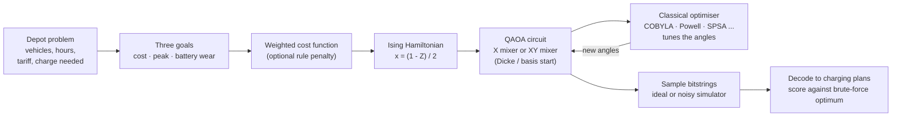
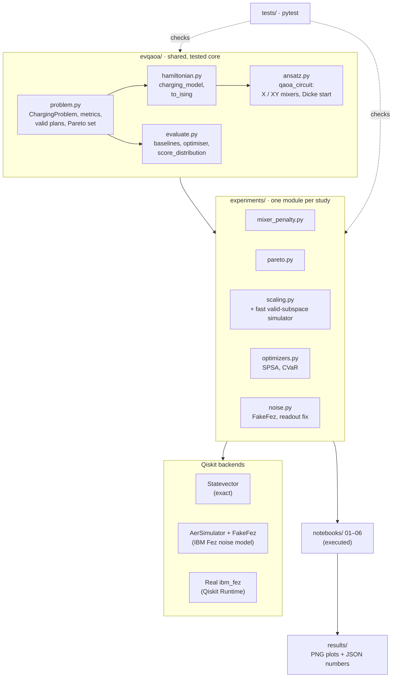

# Overnight EV Charging with QAOA

Interstate Quantum Hackathon 2026 · **QAOA / Optimization for Energy & Grid** track

**New to quantum computing? Start here:** [the project in plain language, with a tray-of-marbles analogy](https://claude.ai/artifact/R5rcXnj69nWHJXSWteLCsP)

## The problem

A depot charges three electric vehicles overnight, from 10 pm to 2 am. Electricity is priced by the hour (32, 14, 9 and 21 cents/kWh). Two vehicles need two hours of charge and the delivery van needs one. We want the plan that best balances three goals:

| Goal | What we measure |
|---|---|
| Low electricity bill | total tariff paid |
| No demand spike | sum over hours of (vehicles charging)², large when charging bunches up |
| Gentle on batteries | number of times a vehicle starts or stops charging |

That gives 12 yes/no decisions (vehicle × hour), so 12 qubits. Of the 4,096 possible bitstrings, only 144 are valid plans.

We start from the hackathon's QAOA starter notebook (Max-Cut on a 5-node graph) and turn it into a full study of this real scheduling problem.

## How it works (high level)



The quantum circuit proposes charging plans and a classical optimiser tunes its angles until good plans come out most often. Every answer is checked against the exact optimum, found by brute force over all 144 valid plans.

**Our key design choice** is the XY mixer. The starter notebook's mixer flips any qubit, so it wanders into plans that break the rules (a vehicle that never charges). The XY mixer only moves a charging hour from one slot to the next *within the same vehicle*, so the number of hours each vehicle charges never changes and every plan it returns is valid.

## System architecture



## Studies and results

| # | Notebook | Question | Main result |
|---|---|---|---|
| 01 | [`01_mixer_penalty_ablation`](notebooks/01_mixer_penalty_ablation.ipynb) | Penalty term vs XY mixer: which keeps answers valid? | XY + Dicke: **100% valid**, optimal plan 10.7% of the time at p = 3. Best penalty setting: 78% valid, 1.8% optimal, never better than a random valid plan. |
| 02 | [`02_pareto_front`](notebooks/02_pareto_front.ipynb) | Can QAOA recover every best trade-off plan? | All 9 Pareto-optimal plans found from 45 weightings. Picking random valid plans finds them just as fast on a problem this small. |
| 03 | [`03_scaling_and_transfer`](notebooks/03_scaling_and_transfer.ipynb) | Does it scale, and can angles be reused? | Up to 25 qubits (5 × 5) with a fast valid-subspace simulator. At p = 1, starting from the 12-qubit angles reaches the target in 1–68 evaluations instead of ~870–1,420. |
| 04 | [`04_optimizers_and_cvar`](notebooks/04_optimizers_and_cvar.ipynb) | Which classical optimiser, and does CVaR help? | With exact energies, L-BFGS-B scores best at p = 2 (approx. ratio 0.827). With 1024-shot noise, Powell holds up best (0.802) while L-BFGS-B drops to 0.644. CVaR gave no gain over the plain average. |
| 05 | [`05_noisy_simulation`](notebooks/05_noisy_simulation.ipynb) | What happens on a noisy IBM chip? | On FakeFez at p = 2, valid share drops from 100% to 34–44%. XY + Dicke with invalid shots discarded finds the optimum 8.2% of the time, about 3× a random valid plan. |
| 06 | [`06_real_hardware`](notebooks/06_real_hardware.ipynb) | Does it hold up on a real IBM quantum computer? | On real **ibm_fez** (8 s of QPU time), valid share was 15–26%, about half of FakeFez's prediction. With invalid shots discarded, XY + Dicke at p = 2 still finds the optimum 6.9% of the time, 2.5× a random valid plan. Readout correction adds only 0.4–2.4 points. |

Every notebook ends with a **Findings & limitations** section. On a problem this small a laptop finds the exact answer instantly. The point of the study is to measure how well the quantum method works and what limits it today.

## Repository layout

```
evqaoa/        shared core: problem, cost model and Hamiltonian, QAOA circuits, scoring
experiments/   one module per study
notebooks/     one executed notebook per study (first cell installs packages)
results/       plots (PNG) and raw numbers (JSON) per study
tests/         pytest suite
```

## Run it

```bash
python -m venv .venv && .venv/bin/pip install -r requirements.txt
.venv/bin/python -m pytest -q tests
.venv/bin/jupyter notebook notebooks/
```

In Google Colab, clone the repository first (`!git clone https://github.com/SakxamShrestha/ev-qaoa-iq-hackathon && %cd ev-qaoa-iq-hackathon`), because the notebooks import `evqaoa/` and `experiments/`.

Notebook 06 re-runs from the saved hardware counts with no IBM account needed. To send new jobs, save your own IBM Quantum account once with `QiskitRuntimeService.save_account(...)` (keys live in `~/.qiskit/`, never in the repo) and set `RUN_ON_IBM = True`.

## References

- E. Farhi, J. Goldstone, S. Gutmann (2014). A Quantum Approximate Optimization Algorithm. arXiv:1411.4028
- S. Hadfield et al. (2019). From the Quantum Approximate Optimization Algorithm to a Quantum Alternating Operator Ansatz. *Algorithms* 12(2):34
- Z. Wang, N. Rubin, J. Dominy, E. Rieffel (2020). XY mixers: analytical and numerical results for QAOA. *Phys. Rev. A* 101, 012320
- P. Barkoutsos et al. (2020). Improving Variational Quantum Optimization using CVaR. *Quantum* 4, 256
- J. C. Spall (1992). Multivariate stochastic approximation using a simultaneous perturbation gradient approximation. *IEEE TAC* 37(3)
- Qiskit documentation and the Interstate Quantum Hackathon 2026 QAOA starter notebook

## License

MIT, see [`LICENSE`](LICENSE).
