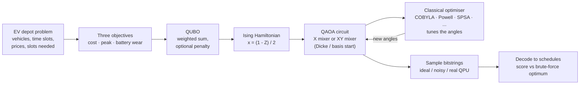
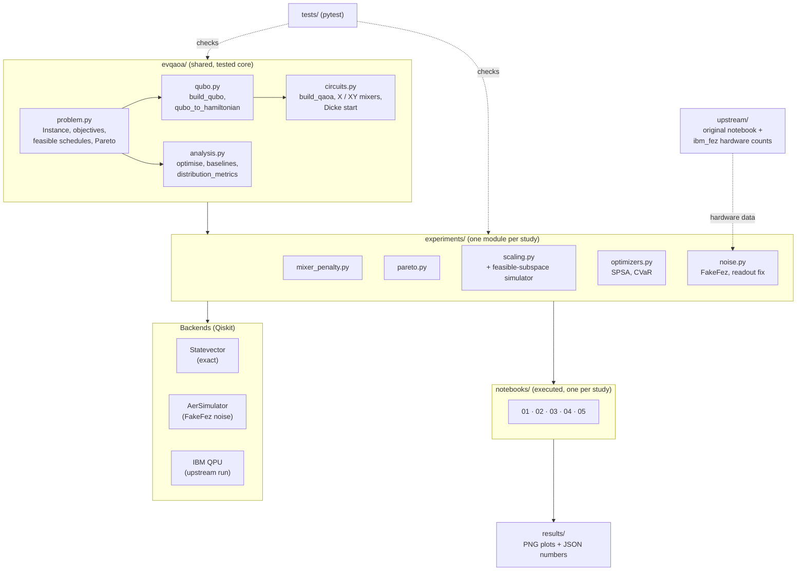

# EV Depot Charging with QAOA: Extended Study

Interstate Quantum Hackathon 2026, **QAOA / Optimization for Energy & Grid** track.

## Starting point and credit

This project builds on [Yankee4567/ev-qaoa](https://github.com/Yankee4567/ev-qaoa) by Yash Khamkar (MIT license), a Qiskit Fall Fest 2026 entry that schedules EV charging at a depot as a three-objective QUBO (cost, peak, battery wear) solved with QAOA. The original notebook, README, license and hardware results are kept unchanged in [`upstream/`](upstream/). The shared code in [`evqaoa/`](evqaoa/) is adapted from that notebook. Everything in `experiments/` and `notebooks/` is new work.

The upstream README lists these as future work. Each one is a notebook here:

| # | Notebook | Upstream future-work item |
|---|---|---|
| 01 | [`01_mixer_penalty_ablation`](notebooks/01_mixer_penalty_ablation.ipynb) | Penalty-weight sweep; X mixer vs constraint-preserving XY mixer |
| 02 | [`02_pareto_front`](notebooks/02_pareto_front.ipynb) | Multiple weightings to rebuild the Pareto front, with a random baseline |
| 03 | [`03_scaling_and_transfer`](notebooks/03_scaling_and_transfer.ipynb) | Larger instances (4x4, 4x5, 4x6), parameter transfer |
| 04 | [`04_optimizers_and_cvar`](notebooks/04_optimizers_and_cvar.ipynb) | CVaR objective; optimizer comparison (upstream: COBYLA capped at 30 evaluations) |
| 05 | [`05_noisy_simulation`](notebooks/05_noisy_simulation.ipynb) | Noisy simulation (FakeFez) compared with upstream's real `ibm_fez` counts |

## How it works (high level)



The quantum computer proposes charging schedules, and a classical optimiser tunes its circuit angles until good schedules come out most often. Every answer is checked against the exact optimum found by brute force.

## System architecture



## Layout

```
evqaoa/        shared, tested core: instance, QUBO, Hamiltonian, QAOA circuits, metrics
experiments/   one module per study
notebooks/     one executed notebook per study (first cell installs packages)
results/       PNG plots and JSON raw numbers per study
tests/         pytest suite
upstream/      original project, unchanged (MIT, Yash Khamkar)
```

## Run

```bash
python -m venv .venv && .venv/bin/pip install -r requirements.txt
.venv/bin/python -m pytest -q tests
.venv/bin/jupyter notebook notebooks/
```

In Google Colab, first clone this repository (`!git clone <repo-url> && %cd <repo>`), because the notebooks import the `evqaoa/` and `experiments/` packages. The first cell of each notebook installs the packages it needs.

## License

MIT. Upstream code copyright Yash Khamkar; see [`upstream/LICENSE`](upstream/LICENSE) and [`LICENSE`](LICENSE).
