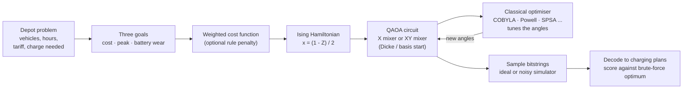
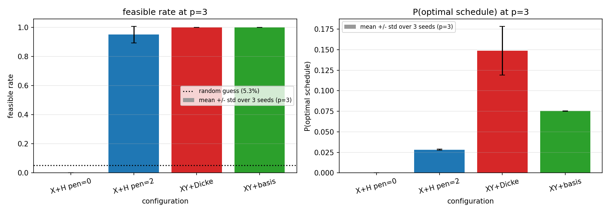
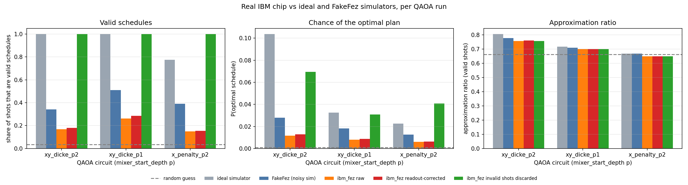

# Overnight EV Charging with QAOA

[](https://www.python.org/downloads/)
[](LICENSE)

Interstate Quantum Hackathon for Beginners, Fall 2026 · **QAOA / Optimization for Energy & Grid** track

**Team Quantum 5 · Rising-star category**
Sakxam Shrestha · Riya Prasai · Mariam · Samyog Karki · Tesfaye Kefene

> **Link to the report: https://docs.google.com/document/d/1sB5kVuTig0f2gD7S0-ZY6JSiMfgtAo4XcQUymAhpaQ4/edit?tab=t.0

> **New to quantum computing?** Read [the project in plain language, with a tray-of-marbles analogy](https://claude.ai/artifact/R5rcXnj69nWHJXSWteLCsP) (supplementary, requires login).
> 
> **Ran on real quantum computers:** [one-page summary of our runs on two IBM chips](https://claude.ai/artifact/DGH4oZcUtW7WnpmY4rKqpv) (supplementary, requires login).

---

## Problem statement

Electric-vehicle fleets charge overnight when electricity is cheapest, but depot operators must juggle competing concerns: minimise the electricity bill, avoid demand spikes that stress the grid, and charge gently to extend battery life. Scheduling which vehicle charges in which hour is a combinatorial optimisation problem, and it grows exponentially with fleet size, making it a natural candidate for quantum optimisation.

We use the **Quantum Approximate Optimisation Algorithm (QAOA)** to solve a concrete instance of this problem and measure how well the quantum approach works today, from ideal simulation through noisy simulation to real IBM quantum hardware.

### The scenario

A depot charges **three electric vehicles** overnight across **four one-hour slots** (10 pm -- 2 am). Electricity is priced by the hour under a time-of-use tariff:

| Slot | 10 pm | 11 pm | 12 am | 1 am |
|------|-------|-------|-------|------|
| Price (cents/kWh) | 32 | 14 | 9 | 21 |

Two vehicles need **two hours** of charge and the delivery van needs **one hour**. That gives **12 yes/no decisions** (vehicle x hour), so **12 qubits**. Of the 4,096 possible bitstrings, only **144 are valid** charging plans.

### Goals

We minimise a weighted combination of three objectives:

| Goal | Metric | Why it matters |
|------|--------|----------------|
| **Low electricity bill** | Total tariff paid | Reduces operating cost |
| **No demand spike** | Sum over hours of (vehicles charging)², penalises bunching | Protects grid infrastructure and avoids demand charges |
| **Gentle on batteries** | Number of start/stop transitions per vehicle | Reduces battery wear and extends fleet lifespan |

We start from the hackathon's QAOA starter notebook (Max-Cut on a 5-node graph) and turn it into a full study of this real scheduling problem.

---

## How it works



The quantum circuit proposes charging plans and a classical optimiser tunes its angles until good plans come out most often. Every answer is checked against the exact optimum, found by brute force over all 144 valid plans.

**Our key design choice** is the XY mixer. The starter notebook's mixer flips any qubit, so it wanders into plans that break the rules (a vehicle that never charges). The XY mixer only moves a charging hour from one slot to the next *within the same vehicle*, so the number of hours each vehicle charges never changes and every plan it returns is valid.

---

## Key results

<p align="center">
  
  
</p>
<p align="center">
  <em>Left: XY + Dicke mixer achieves 100% valid plans vs 78% for the best penalty setting. Right: real IBM hardware results compared to simulators.</em>
</p>

---

## Studies and results

**Core story** (start here):

| # | Notebook | Question | Main result |
|---|---|---|---|
| 01 | [`01_mixer_penalty_ablation`](notebooks/01_mixer_penalty_ablation.ipynb) | Penalty term vs XY mixer: which keeps answers valid? | XY + Dicke: **100% valid**, optimal plan 10.7% of the time at p = 3. Best penalty setting: 78% valid, 1.8% optimal, never better than a random valid plan. |
| 05 | [`05_noisy_simulation`](notebooks/05_noisy_simulation.ipynb) | What happens on a noisy IBM chip? | On FakeFez at p = 2, valid share drops from 100% to 34--44%. XY + Dicke with invalid shots discarded finds the optimum 8.2% of the time, about 3x a random valid plan. |
| 06 | [`06_real_hardware`](notebooks/06_real_hardware.ipynb) | Does it hold up on a real IBM quantum computer? | On real **ibm_fez** (8 s of QPU time), valid share was 15--26%, about half of FakeFez's prediction. With invalid shots discarded, XY + Dicke at p = 2 still finds the optimum 6.9% of the time, 2.5x a random valid plan. Readout correction adds only 0.4--2.4 points. |

**Extended exploration** (extra questions we followed up):

| # | Notebook | Question | Main result |
|---|---|---|---|
| 02 | [`02_pareto_front`](notebooks/02_pareto_front.ipynb) | Can QAOA recover every best trade-off plan? | All 9 Pareto-optimal plans found from 45 weightings. Picking random valid plans finds them just as fast on a problem this small. |
| 03 | [`03_scaling_and_transfer`](notebooks/03_scaling_and_transfer.ipynb) | Does it scale, and can angles be reused? | Up to 25 qubits (5 x 5) with a fast valid-subspace simulator. At p = 1, starting from the 12-qubit angles reaches the target in 1--68 evaluations instead of ~870--1,420. |
| 04 | [`04_optimizers_and_cvar`](notebooks/04_optimizers_and_cvar.ipynb) | Which classical optimiser, and does CVaR help? | With exact energies, L-BFGS-B scores best at p = 2 (approx. ratio 0.827). With 1024-shot noise, Powell holds up best (0.802) while L-BFGS-B drops to 0.644. CVaR gave no gain over the plain average. |
| 07 | [`07_hardware_robustness`](notebooks/07_hardware_robustness.ipynb) | Does the result hold on a second chip, and does zero-noise extrapolation recover the noise-free answer? | On **ibm_kingston** (8 s of QPU time) the same circuits kept 22–35% valid shots, 1.3–1.7× more than ibm_fez and still below FakeFez. With invalid shots discarded, XY + Dicke p = 2 finds the optimum 8.4% vs 6.9% on fez, the same within shot noise. ZNE on ibm_fez (25 s) lifts p = 2 P(valid) from 0.16 to 0.39 ± 0.04 (ideal 1.0), about a quarter of the gap; the answer depends on the fit. |
| 08 | [`08_real_fleet_data`](notebooks/08_real_fleet_data.ipynb) | Does the model work on real fleet data? | On 50 nights built from real delivery-truck schedules (NLR Fleet DNA), XY + Dicke returns a best plan a median 2.4× (p = 1) and 2.6× (p = 2) as often as a random valid plan; p = 1 beats random on all 50 nights. QAOA's plans cost about as much as the best plan and keep the depot peak near 230 kW, against 300 kW for simple charging rules. Prices are still placeholders, so the dollar figures are not real yet. |

Every notebook ends with a **Findings & limitations** section. On a problem this small a laptop finds the exact answer instantly. The point of the study is to measure how well the quantum method works and what limits it today.

---

## Repository layout

```
evqaoa/            shared library used by every notebook
  problem.py         problem definition, metrics, brute-force enumeration
  hamiltonian.py     Ising encoding of the cost function
  ansatz.py          QAOA circuits (X mixer, XY mixer, Dicke initialisation)
  evaluate.py        scoring and approximation-ratio helpers
  real_data.py       real truck schedules turned into charging problems (study 08)
experiments/       one module per study (called by notebooks)
notebooks/         one executed notebook per study (first cell installs packages)
results/           plots (PNG) and raw numbers (JSON) per study
  01_mixer_penalty/    mixer vs penalty ablation plots
  02_pareto/           Pareto-front recovery plots
  03_scaling/          scaling and angle-transfer data
  04_optimizers/       optimiser comparison charts
  05_noise/            noisy simulation results
  06_hardware/         real IBM hardware results
  07_hardware_extra/   second-chip and ZNE results
  08_real_fleet/       real-fleet-data results
data/              real truck schedules used by study 08 (NLR, BSD-3; see data/nlr_fleet_2021/SOURCE.md)
tests/             pytest suite (test_core.py and test_real_data.py for evqaoa/, one file per experiments/ module)
```

---

## Run it

**Requirements:** Python 3.11+, pip

```bash
python -m venv .venv && .venv/bin/pip install -r requirements.txt
.venv/bin/python -m pytest -q tests
.venv/bin/jupyter notebook notebooks/
```

### Google Colab

Open any notebook in Colab and run it from the top. The second cell clones the repo and installs dependencies automatically. To do it by hand:

```
!git clone https://github.com/SakxamShrestha/quant5-fisk-IQ-hackathon
%cd quant5-fisk-IQ-hackathon/notebooks
```

> **Note:** The clone URL above points to the upstream repo. Update it if you are working from a fork.

### Real hardware (optional)

Notebook 06 re-runs from the saved hardware counts with no IBM account needed. To send new jobs, save your own IBM Quantum account once with `QiskitRuntimeService.save_account(...)` (keys live in `~/.qiskit/`, never in the repo) and set `RUN_ON_IBM = True`.

---

## References

- E. Farhi, J. Goldstone, S. Gutmann (2014). A Quantum Approximate Optimization Algorithm. [arXiv:1411.4028](https://arxiv.org/abs/1411.4028)
- S. Hadfield et al. (2019). From the Quantum Approximate Optimization Algorithm to a Quantum Alternating Operator Ansatz. *Algorithms* 12(2):34. [doi:10.3390/a12020034](https://doi.org/10.3390/a12020034)
- Z. Wang, N. Rubin, J. Dominy, E. Rieffel (2020). XY mixers: analytical and numerical results for QAOA. *Phys. Rev. A* 101, 012320. [arXiv:1904.09314](https://arxiv.org/abs/1904.09314)
- P. Barkoutsos et al. (2020). Improving Variational Quantum Optimization using CVaR. *Quantum* 4, 256. [arXiv:1907.04769](https://arxiv.org/abs/1907.04769)
- J. C. Spall (1992). Multivariate stochastic approximation using a simultaneous perturbation gradient approximation. *IEEE TAC* 37(3). [doi:10.1109/9.119632](https://doi.org/10.1109/9.119632)
- K. Temme, S. Bravyi, J. M. Gambetta (2017). Error mitigation for short-depth quantum circuits. *Phys. Rev. Lett.* 119, 180509. [doi:10.1103/PhysRevLett.119.180509](https://doi.org/10.1103/PhysRevLett.119.180509)
- L. Zhou, S.-T. Wang, S. Choi, H. Pichler, M. D. Lukin (2020). Quantum Approximate Optimization Algorithm: Performance, Mechanism, and Implementation on Near-Term Devices. *Phys. Rev. X* 10, 021067. [doi:10.1103/PhysRevX.10.021067](https://doi.org/10.1103/PhysRevX.10.021067)
- B. Borlaug, M. Muratori, M. Gilleran et al. (2021). Heavy-duty truck electrification and the impacts of depot charging on electricity distribution systems. *Nature Energy* 6, 673–682. [doi:10.1038/s41560-021-00855-0](https://doi.org/10.1038/s41560-021-00855-0). Truck schedules: NLR dataset [doi:10.7799/1787031](https://doi.org/10.7799/1787031)
- Qiskit documentation and the Interstate Quantum Hackathon 2026 QAOA starter notebook

## License

MIT, see [`LICENSE`](LICENSE).
