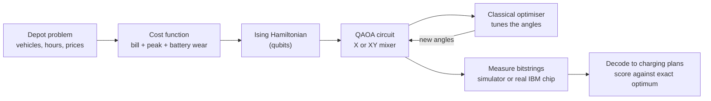
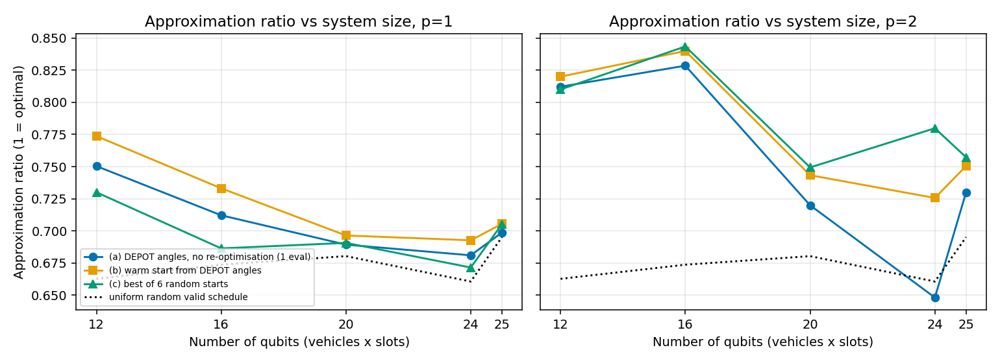
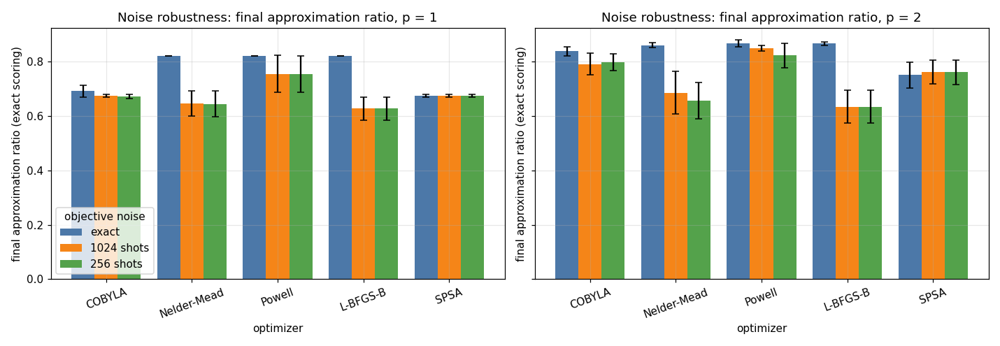
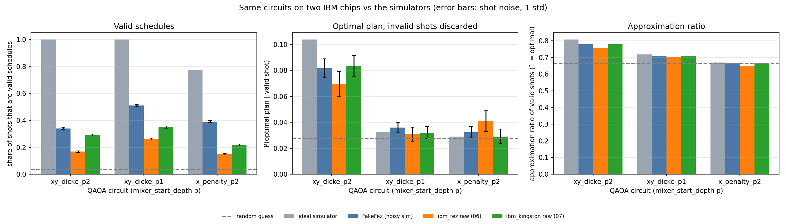
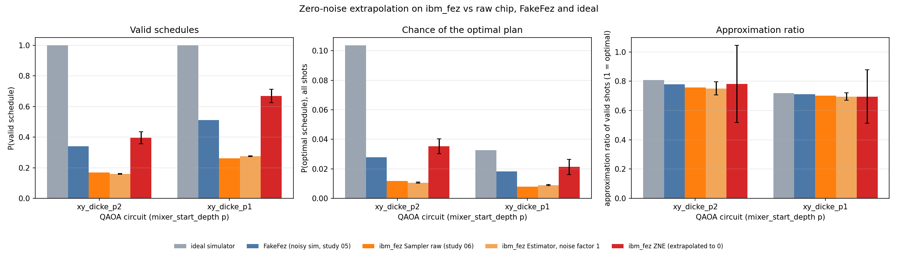

# Project Report: Overnight EV Charging with QAOA

**Interstate Quantum Hackathon for Beginners, Fall 2026 · QAOA track**

## Team

**Group name:** Quantum 5

| Name | Affiliation | Department | Career level |
|---|---|---|---|
| Sakxam Shrestha | _TODO_ | _TODO_ | _TODO_ |
| Riya Prasai | _TODO_ | _TODO_ | _TODO_ |
| Mariam _TODO surname_ | _TODO_ | _TODO_ | _TODO_ |
| Samyog Karki | _TODO_ | _TODO_ | _TODO_ |
| Tesfaye Kefene | _TODO_ | _TODO_ | _TODO_ |

**Submission category:** Rising-star (beginners with no or very basic prior experience in quantum mechanics)

**Repository:** https://github.com/SakxamShrestha/quant5-fisk-IQ-hackathon

---

## Summary of what we did

- Took the hackathon's QAOA starter notebook (Max-Cut on 5 nodes) and applied QAOA to a real energy problem: scheduling overnight charging for 3 electric vehicles across 4 hourly price slots (12 qubits).
- Wrote the problem as a QUBO with three goals: a low electricity bill, no demand spike, and few battery start/stop cycles.
- Compared two ways to enforce the rule "each vehicle gets the hours it needs": a penalty term with the standard X mixer, and an XY mixer that can only produce valid plans. The XY mixer gave **100% valid plans** in simulation; the best penalty setting gave 78%.
- Explored the hackathon's suggested topics: different mixers, different classical optimisers, and system size (12 to 25 qubits). We also found the full set of best trade-off plans (Pareto front).
- Simulated a noisy IBM chip (FakeFez), then ran our circuits on **two real IBM quantum computers**, ibm_fez and ibm_kingston, using 41 seconds of free-plan quantum time in total.
- On real hardware, after discarding invalid shots, our main circuit found the cheapest plan **6.9% (fez) and 8.4% (kingston)** of the time. Picking a random valid plan finds it 2.8% of the time.
- Tried zero-noise extrapolation (ZNE), an error-mitigation method. It recovered about a quarter of the gap to the noise-free answer for our deeper circuit and about half for the shallower one.
- Checked every result against the exact answer found by brute force, and kept negative results in the report.

## Motivation

We chose the QAOA track because it connects quantum computing to a practical question: how to make a good choice among many options. The hackathon's theme included energy and electric grids, and EV charging is a problem we can all picture. More electric cars are plugging in every night, and charging them all at the same time raises both electricity bills and the strain on the grid.

The starter notebook solves Max-Cut, a textbook graph problem. We wanted to find out what changes when QAOA meets a problem with real rules, like "this van must charge for exactly one hour". That question led to our main lesson: the hard part is not the circuit itself but keeping the answers valid.

## Our starting point and how we learned

All five of us started as beginners. Before the training sessions (Oct 9 and Oct 16) we had not built a quantum circuit. Our path:

1. **Ran the organizers' QAOA starter notebook** and learned the basic loop: cost Hamiltonian, mixer, measure, let a classical optimiser tune the angles.
2. **Changed the problem.** Writing EV charging as a QUBO showed us that most of the 4,096 possible bitstrings break the rules. Only 144 are valid plans.
3. **Hit our first wall.** With the starter notebook's X mixer, almost every answer was invalid. Adding a penalty helped, but the penalty weight was hard to tune.
4. **Learned about the XY mixer** from the papers by Hadfield et al. (2019) and Wang et al. (2020). It moves a charging hour from one slot to another within the same vehicle, so the number of hours each vehicle charges stays fixed.
5. **Moved from simulators to real hardware** with a free IBM Quantum account, and learned how much noise changes the picture.

We built on an existing open-source EV-charging QAOA example (https://github.com/Yankee4567/ev-qaoa) as a reference when we started. We then rewrote the core code on our own problem instance (our own tariff and vehicle demands) and ran all of the studies ourselves; the first two commits in our history still contain that reference code. We used AI coding assistants (Claude) to help write and test code and to draft text. Every result was run, checked against brute force and discussed by the team.

## Workflow: how the code works

1. **Problem** (`evqaoa/problem.py`): 3 vehicles × 4 hours (10 pm to 2 am) = 12 yes/no choices, one qubit each. Prices are 32, 14, 9 and 21 cents/kWh. Two vehicles need 2 hours of charge, the van needs 1.
2. **Cost function to Hamiltonian** (`evqaoa/hamiltonian.py`): the three goals are weighted 0.5 (bill), 0.3 (peak), 0.2 (battery wear) and turned into a Hamiltonian of Pauli-Z terms using x = (1 − Z)/2.
3. **QAOA circuit** (`evqaoa/ansatz.py`): p layers of "cost then mixer". The X mixer is the starter notebook's; the XY mixer keeps every plan valid. The XY version starts from a Dicke state, an equal mix of all valid plans.
4. **Optimise** (`evqaoa/evaluate.py`): a classical optimiser (COBYLA by default) tunes the 2p angles to lower the average cost.
5. **Score**: sample 4,096 shots and report three numbers:
   - **valid share:** the fraction of shots that are valid plans;
   - **P(optimal):** how often the cheapest plan appears;
   - **approximation ratio:** how close the average plan is to the best (1 = optimal).
6. **Studies** (`experiments/`, `notebooks/01`–`07`): one module and one executed notebook per question. A test suite (107 tests) checks the core and each study.

To run: open any notebook in Colab or Jupyter. The first cell installs all packages. The hardware notebooks replay our saved IBM results by default, so they run without an IBM account.

---

## Results

### 1. The XY mixer keeps every answer valid (notebook 01)

- **Without a penalty, the X mixer almost never produces a valid plan.**
- **A penalty of 5 raises the valid share to 78%,** but the circuit finds the optimal plan only 1.8% of the time, no better than picking a random valid plan (2.8%).
- **The XY mixer with a Dicke start gives 100% valid plans** and finds the optimal plan **10.7%** of the time, almost 4× random.
- **The Dicke start matters:** XY from a single basis state is also 100% valid but only reaches 2.2% optimal.

**Lesson:** for problems with rules, building the rules into the mixer works far better than adding a penalty.

### 2. Larger problems and reusing angles (notebook 03)

- **We scaled from 12 to 25 qubits** (up to 5 vehicles × 5 hours), using a fast simulator that only tracks valid plans.
- **Quality drops as the problem grows.** At p = 2 the approximation ratio falls from 0.82 (12 qubits) toward the random-guess line at 24–25 qubits.
- **The 12-qubit angles transfer to bigger problems.** At p = 1, starting from them reached the target in 1–68 optimiser evaluations instead of about 870–1,420.

### 3. Which classical optimiser? (notebook 04)

- **With exact energies,** L-BFGS-B scored best (0.827 at p = 2).
- **With realistic shot noise** (1,024 shots), Powell held up best (0.802) and L-BFGS-B dropped to 0.644.
- **CVaR,** a variant that scores only the best shots, gave no gain on our problem.

### 4. Real IBM quantum computers (notebooks 06 and 07)

We ran three circuits on two real 156-qubit IBM chips (4,096 shots each, with IBM's dynamical decoupling and twirling switched on):

| Circuit | Ideal sim | FakeFez (noisy sim) | ibm_fez | ibm_kingston |
|---|---|---|---|---|
| **Valid share:** XY + Dicke, p = 2 | 100% | 34.1% | 16.9% | 29.2% |
| **Valid share:** XY + Dicke, p = 1 | 100% | 51.0% | 26.1% | 35.1% |
| **Valid share:** X + penalty, p = 2 | 77.5% | 39.1% | 14.9% | 21.8% |
| **P(optimal), invalid shots discarded:** XY + Dicke, p = 2 | 10.4% | 8.2% | 6.9% | 8.4% |

- **Noise removes most valid answers.** The real chips kept 15–35% valid shots. The noisy simulator was too optimistic, by about 2× on ibm_fez.
- **The useful signal survives.** After discarding invalid shots, our main circuit still finds the cheapest plan **2.5–3× more often than random** on both chips.
- **Both chips rank the three circuits in the same order.** ibm_kingston was less noisy than ibm_fez.
- **Measurement error is small** (about 1.5% per qubit). Most of the noise comes from the 357 two-qubit gates in the main circuit.

### 5. Can error mitigation recover the noise-free answer? (notebook 07)

Zero-noise extrapolation runs the circuit at higher noise levels on purpose and extrapolates back to zero noise. On ibm_fez:

| | Ideal | Real chip | Real chip + ZNE |
|---|---|---|---|
| Valid share, p = 2 | 100% | 16.0% | 39.5% ± 3.9 |
| Valid share, p = 1 | 100% | 27.6% | 66.9% ± 4.5 |
| P(optimal), p = 2 | 10.4% | 1.1% | 3.5% ± 0.5 |

- **ZNE helps but does not reach the ideal.** It closes about 27% of the gap for p = 2 and 53% for p = 1.
- **The deeper circuit recovers less** because it has too little signal left at higher noise.

---

## Conclusions

1. **QAOA works on a real scheduling problem, and the mixer is what makes it work.** With the XY mixer, every simulated answer was a valid charging plan.
2. **On today's real hardware, noise is the main limit.** Valid answers fell from 100% to 15–35%. Even so, the circuit still favours the cheapest plan clearly above chance on two different chips.
3. **Shallower circuits survive noise better, deeper circuits find better answers.** Choosing the depth is a trade-off on current hardware.

## Limitations

- Our problem is small. A laptop finds the exact answer instantly by checking all 144 plans; the point was to measure how well QAOA does.
- We made one run per chip, on one day. Hardware calibration changes from day to day.
- Our prices are an example tariff, not live market data.
- With 4,096 shots, the hardware P(optimal) values carry about ±1 percentage point of sampling error.

## What we would do next

- Use real hourly grid prices (for example the MISO day-ahead price at the TVA interface, which is public).
- Compare against classical methods such as greedy scheduling and simulated annealing.
- Tune the circuit angles on the noisy chip itself instead of on a perfect simulator.

## References

- E. Farhi, J. Goldstone, S. Gutmann (2014). A Quantum Approximate Optimization Algorithm. arXiv:1411.4028
- S. Hadfield et al. (2019). From the Quantum Approximate Optimization Algorithm to a Quantum Alternating Operator Ansatz. *Algorithms* 12(2):34
- Z. Wang, N. Rubin, J. Dominy, E. Rieffel (2020). XY mixers: analytical and numerical results for QAOA. *Phys. Rev. A* 101, 012320
- P. Barkoutsos et al. (2020). Improving Variational Quantum Optimization using CVaR. *Quantum* 4, 256
- Qiskit and Qiskit IBM Runtime documentation; Interstate Quantum Hackathon 2026 QAOA starter notebook
